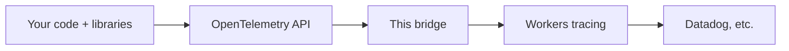
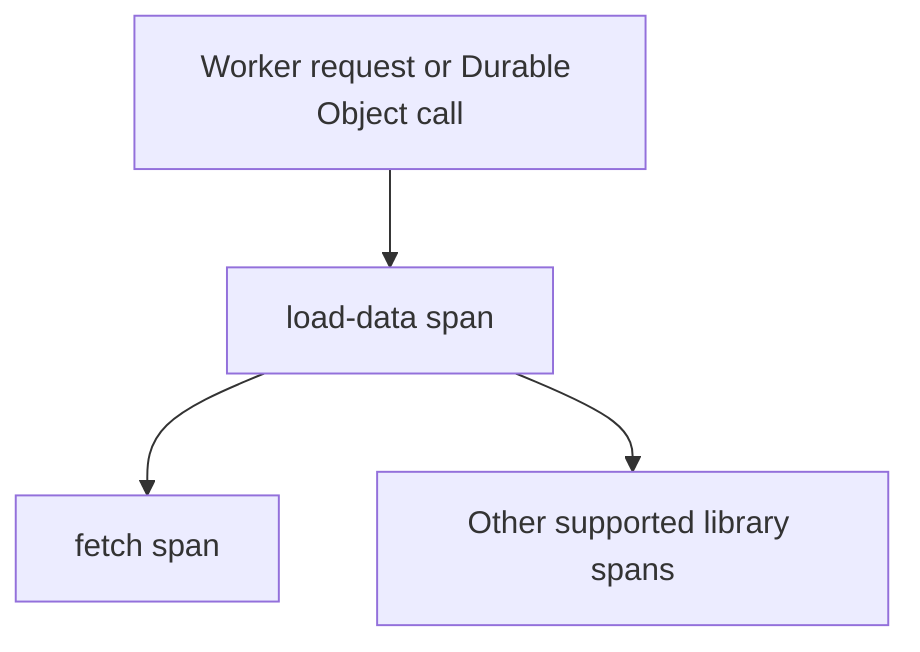

# OpenTelemetry → Workers tracing

Let your existing OpenTelemetry (OTel) code use Cloudflare Workers' built-in tracing.

This bridge connects the OTel API your libraries call to the tracing built into Workers.



This bridge supports **part of the tracing API**. See [compatibility details](docs/compatibility.md).

## Get started

### 1. Copy the adapter into your project

We recommend vendoring the adapter: copy [src/index.ts](src/index.ts) into your
Worker project as `src/otel.ts`. Keep a copy of [LICENSE](LICENSE) alongside it
as `src/otel.LICENSE`.

Use your project's existing `@opentelemetry/api` (1.9+) or add it:

```sh
npm install '@opentelemetry/api@^1.9.0'
```

The adapter is now part of your code. No adapter package or build step is needed.

### 2. Turn on Workers tracing

In `cloudflare.config.ts`:

```ts
import { defineConfig } from 'cf/config';

export default defineConfig({
  worker: {
    name: 'my-worker',
    entrypoint: './src/index.ts',
    compatibilityDate: '2026-10-26',
    observability: {
      enabled: true,
      traces: { enabled: true, headSamplingRate: 1 },
    },
  },
});
```

Start with sampling rate `1` to check your traces. Lower it later if needed.
Set up your destination using [Workers OpenTelemetry export](https://developers.cloudflare.com/workers/observability/opentelemetry-export/).

### 3. Register once

Add these lines at the top of your Worker, outside any handler:

```ts
import { register } from './otel.js';

register();
```

Remove your old tracing setup first, such as `otel-cf-workers` or `NodeSDK`.
Repeated calls and dev reloads are safe; a different installed provider causes an error.

Your libraries can keep using their usual OTel imports.

## Common examples

Run these inside a Worker or Durable Object handler, after registration.

**Add trace IDs to logs:**

```ts
import { trace } from '@opentelemetry/api';

const ids = trace.getActiveSpan()?.spanContext();
console.log({ message: 'Handling request', trace_id: ids?.traceId, span_id: ids?.spanId });
```

IDs can be missing or zero when tracing is unavailable. Use them for logs;
do not build outgoing `traceparent` headers from them. [Why?](docs/compatibility.md#context-boundaries)

**Enable AI SDK tracing:**

```ts
import { generateText } from 'ai';

await generateText({
  model,  // Your existing model
  prompt, // Your existing prompt
  experimental_telemetry: {
    isEnabled: true,
    recordInputs: false,
    recordOutputs: false,
  },
});
```

**Trace a step yourself:**

```ts
const tracer = trace.getTracer('my-worker');

await tracer.startActiveSpan('load-data', async span => {
  try {
    span.setAttribute('cache.hit', false);
    return await fetch('https://example.com/data');
  } finally {
    span.end();
  }
});
```

`startActiveSpan()` puts work inside that step:



Always end spans you create. In Durable Objects, create fresh spans for each call;
keep live spans and contexts out of object fields and storage.
Use `ctx.waitUntil()` for work that must continue after returning a response.

## Limits to know

| Works | Limited or unsupported |
| --- | --- |
| Spans under the current native parent | New roots, different parents, non-`INTERNAL` span kinds, custom start times and creation links do not record. |
| Text, number and boolean attributes | Arrays and objects are dropped. |
| Status, rename and exceptions | Other events and links are dropped. Custom end/exception times are ignored. |
| Async OTel context and baggage | `context.with()` cannot make an existing span active in the runtime. Use `startActiveSpan()` for native nesting. |
| Tracing | OTel metrics, the logs SDK and SDK span processors are outside this bridge. |

When a span cannot be recorded, **your callback still runs**. The bridge keeps valid
parent IDs when available; it does not invent a new span.

To see unsupported operations:

```ts
import { diag, DiagConsoleLogger, DiagLogLevel } from '@opentelemetry/api';

diag.setLogger(new DiagConsoleLogger(), DiagLogLevel.WARN);
```

[Full API and runtime details →](docs/compatibility.md)

## Develop

```sh
npm ci
npm run verify        # Types, integration tests, real Workers + Durable Objects
npm run dev           # Example at http://127.0.0.1:8799
npm run build:example # Build the example without deploying
```

Tests use local services and synthetic data, with no vendor credentials.
This repo runs the Cloudflare Vite plugin directly because `cf dev`/`cf build`
currently reject its mix of framework test dependencies. Customer projects can keep using `cf`.
